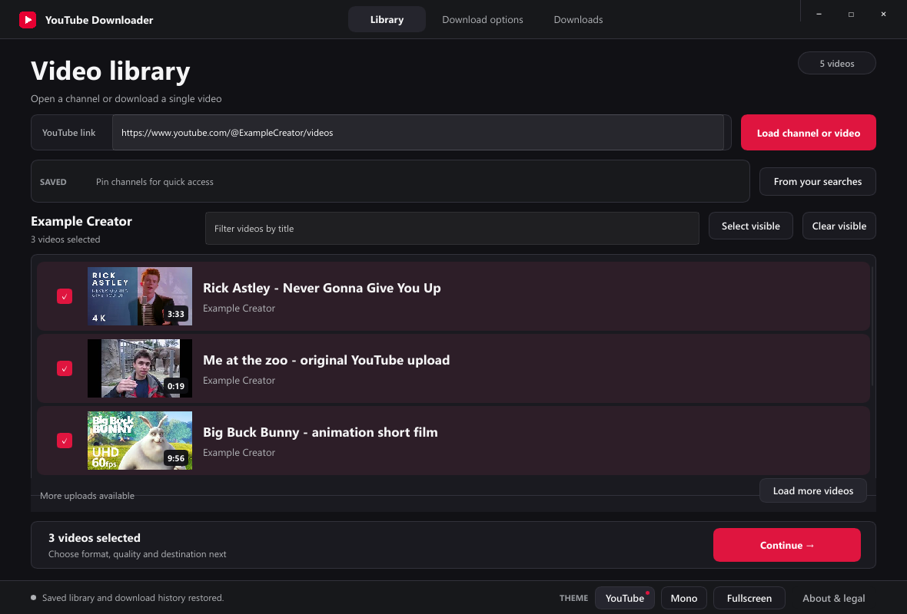
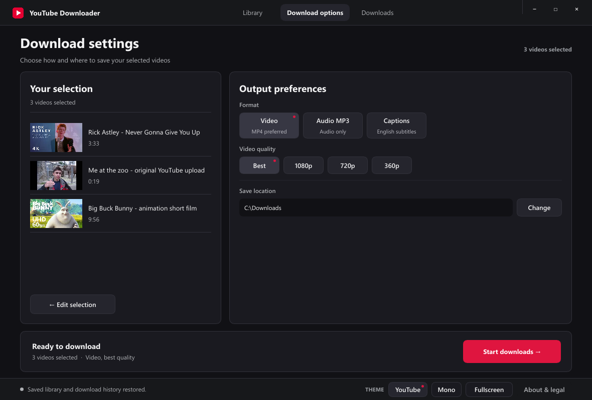
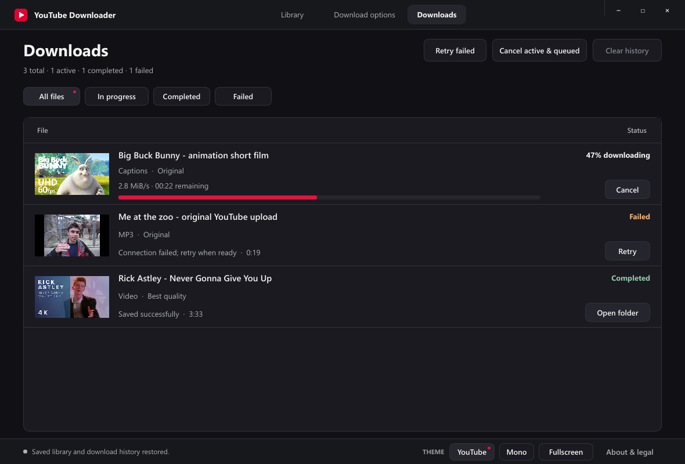
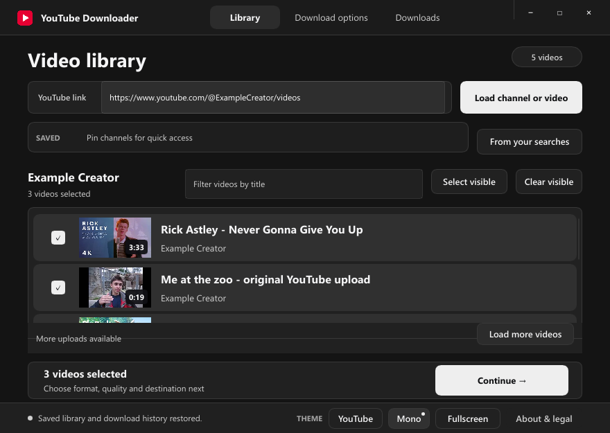

# YouTube Downloader Desktop

**Windows x64 | Beta | Free and open source**

A native Windows app for browsing public YouTube channels and saving permitted videos, MP3 audio, or available captions. Paste a channel link to browse uploads, or paste a video or Shorts link to go straight to download settings.

**[Download the published Desktop Beta](https://github.com/Ticklect/youtube-downloader-desktop/releases/latest)** · [Screenshots](#screenshots)

The walkthrough and screenshots below show the current source tree. The published Beta may be an earlier build.

## Install

1. Open the [latest Desktop Beta release](https://github.com/Ticklect/youtube-downloader-desktop/releases/latest) and download the standalone Windows x64 EXE.
2. Run **`youtubedownloderbeta.exe`**. The standalone build embeds yt-dlp, FFmpeg, FFprobe, and Deno; you do not need to download those tools or keep a `bin` folder beside the EXE.
3. Keep the accompanying third-party notices file with the EXE; it contains the bundled tools' license texts and attributions.

On first launch, the app extracts the embedded tools into a versioned directory under `%LOCALAPPDATA%\YouTube Downloader Desktop\tools\`. This is separate from the saved session and thumbnail cache, so updating or extracting the runtime does not reset your settings, saved channels, selected videos, or download history. The app does not require a separate installation of Rust, Python, FFmpeg, or yt-dlp.

The Beta is currently **Windows x64 only**. It has no installer and is not Authenticode-signed, so Windows may show a publisher or reputation warning. Only run an EXE obtained from a source you trust and verify its published SHA-256 when one is provided. Signing would require a trusted code-signing certificate; bundling dependencies does not remove Windows trust warnings.

Older Windows x64 ZIP packages contain the EXE and a separate `bin` directory. They are legacy portable packages and are **not** the standalone single-EXE build described above.

## How to use it

1. Paste a public YouTube channel, video, Shorts, or `youtu.be` link into **Library**, then click **Load channel or video**.
2. For a channel, select the videos you want and click **Continue**. The title filter searches loaded uploads. **Load more videos** works while the filter is active. A single-video link goes straight to **Download settings**.
3. Choose Video, Audio MP3, or Captions and a save location. Video downloads also offer a quality setting.
4. Click **Start downloads**. In **Downloads**, you can check progress, retry a failure, cancel a job, and reveal a newly completed file with **Show in folder**. Earlier records still offer **Open folder**.

Use **From your searches** to pin frequently visited channels to the **Saved** shelf. Suggestions come from successful channel loads on this computer. The footer lets you switch between **YouTube Red** and **Mono** or enter fullscreen.

## Screenshots

**Library**



| Download options | Downloads and history |
| :---: | :---: |
|  |  |

**Mono theme at minimum window size**



Screenshots use isolated sample data.

## What it supports

| Feature | Current Beta |
| --- | --- |
| Channel browsing | Up to 1,000 upload positions in batches of 200, with the next page saved across restarts |
| Direct downloads | A public watch, Shorts, or `youtu.be` link opens Download settings |
| Channel shortcuts | Suggested channels based on your local successful channel searches; pin to or remove from the saved channels bar |
| Video | Best available, 1080p, 720p, or 360p, when available |
| Audio | MP3 output |
| Captions | English captions, if available for the video |
| Downloads | Folder selection, progress, cancellation, retries, queue recovery, and completed-file locations |
| Processing | yt-dlp, FFmpeg, FFprobe, and Deno embedded in the standalone EXE and extracted locally on first launch |

Some uploads, formats, or captions may not be available. YouTube can change how videos are delivered, so not every download will succeed. Private, members-only, login-restricted, and DRM-protected content are not supported. This is a **Beta**, not a guarantee of uninterrupted downloads.

Scroll near the end of the unfiltered list or click **Load more videos** to browse older uploads. Selections stay checked while the next batch loads. If a page fails, click **Retry loading**. If a disk or permission issue prevents the queue from saving, resolve the issue and click **Retry saving and resume**.

## Responsible use and legal notice

**Only use this software to download material you are permitted to download.** For example, this may include videos you created, material for which you have the rights holder's permission, or content whose licence or applicable law permits downloading. Check the actual permissions before downloading: **a video being publicly viewable does not automatically mean you have permission to save or redistribute it.**

You are responsible for your own use of the software, including complying with copyright law, privacy rights, applicable regulations, and the terms of any platform or service you access. Do not use it to infringe someone else's rights or bypass DRM, paywalls, authentication, or other access restrictions. Downloading a file does not grant permission to republish or distribute it.

**Disclaimer:** This project is provided **"as is"**, without warranties, as described in the [AGPL-3.0 licence](LICENSE). To the extent permitted by applicable law, the authors and maintainers disclaim liability for misuse of the software, infringement by users, lost data, service restrictions, or other damage arising from its use. **This notice does not automatically remove legal liability or override rights and obligations that cannot legally be excluded.**

This is an independent project. It is **not affiliated with, sponsored by, or endorsed by YouTube or Google**. YouTube and Google names and marks belong to their respective owners.

## For developers

The desktop app is written in **Rust** and uses **Slint** for its native UI. On Windows, install stable Rust with the MSVC toolchain and Windows SDK/C++ build tools, then run:

```powershell
cargo fmt --all -- --check
cargo test --locked
cargo clippy --locked --all-targets -- -D warnings
powershell -NoProfile -ExecutionPolicy Bypass -File scripts/package-windows.ps1 -Tag Local-Build
```

The packaging script downloads and checksum-verifies the upstream tool assets, freshly extracts the verified archives, builds a raw-DEFLATE payload, and passes its path and SHA-256 into a required embedded-runtime release build. It creates a standalone EXE and a `THIRD-PARTY-NOTICES Local-Build.txt` file under `dist/`. Output names are immutable: the script refuses to overwrite an existing output, so use a new `-Tag` for each package. Packaging requires network access to the upstream release and checksum URLs.

To run the Windows GUI smoke tests against that EXE:

```powershell
powershell -NoProfile -ExecutionPolicy Bypass -File scripts/smoke-beta-acceptance.ps1 -Executable 'dist\YouTube Downloader Desktop Beta Local-Build.exe' -CaptureMatrix
```

Those tests use isolated sample data, not your real downloaded files. Your regular app settings and history are stored under `%LOCALAPPDATA%\YouTube Downloader Desktop\`.

## Other versions and licences

A separate **browser-only extension** is being developed as an alternative for people who do not want a desktop app. It is experimental, has different download limitations, and is **not included in this repository or release**. The old extension-plus-Python-helper project is retired; its source remains in Git history, not in the current desktop codebase.

This project's source is licensed under **[AGPL-3.0](LICENSE)**. The UI uses [Slint](https://slint.dev/) and includes its attribution under **About & legal**. The standalone package accompanies the complete project license and license texts for yt-dlp, FFmpeg, and Deno in its third-party notices file. See [third-party notices and upstream sources](docs/THIRD-PARTY-NOTICES.md) for attribution and license source links.
